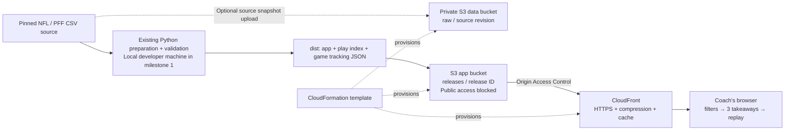
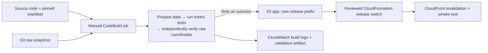

# AWS architecture and delivery plan

## Recommendation

Move the proven read-only application to Amazon S3 and Amazon CloudFront first. Keep metric calculation and replay rendering in the browser. The source dataset is fixed, the processed application is about 114 MB, and a session loads only the play index and the tracking games it opens. An API and database do not currently solve a demonstrated bottleneck.

The project owner confirmed that there are no required AWS services. This architecture follows the read-only coaching workflow. No AI-track eligibility or unseen judging criteria are assumed.

## Milestone 1 — AWS-hosted coaching demo

The repository includes the CloudFormation template and deployment runbook. No AWS resources have been deployed by this work. The existing private demo uses Sites, not this AWS stack.

| Component | Purpose | MVP implementation |
| --- | --- | --- |
| S3 app bucket | Store app assets and processed tracking under release prefixes | Template included; encrypted, versioned, public access blocked |
| S3 data bucket | Keep an optional raw snapshot and its provenance separate from the web origin | Template included; no CloudFront access grant |
| CloudFront | Serve the browser app and JSON over HTTPS; cache and compress responses | Template included; distribution disabled until public access is explicitly enabled |
| Origin Access Control | Let only the configured CloudFront distribution read app objects through its service grant | Template included; does **not** authenticate viewers |
| CloudFormation | Make AWS infrastructure reviewable and reproducible | `infra/aws/template.json` |
| Python preparation | Join scouting, apply eligibility rules and convert observed coordinates | Implemented; runs locally at this milestone |
| Browser metric engine | Compute filtered counts and evidence sets deterministically | Already implemented and tested |
| CloudWatch | Inspect standard service metrics after deployment | Runbook instructions; no custom dashboard or alarms provisioned |

### Request and data flow

The browser requests `data/brief.json` (3,971,225 bytes in the current build), then the selected game's `data/tracking/<gameId>.json`. All game bundles are included. Five game bundles are cached in browser memory. Filtering does not issue database queries or rebuild the dataset.

Opponent/down/distance/play query parameters select client-side state. CloudFront deliberately ignores query parameters in its cache key because the underlying files are identical. HTML remains `index.html`; missing JSON must remain an error instead of returning HTML with a 200 response.

Cache policy: minimum TTL 0, maximum TTL 3,600 seconds. Uploads specify browser revalidation and a shared-cache lifetime. Gzip/Brotli are enabled; actual edge compression and latency must be checked after deployment. AWS documents compression as best-effort for supported objects between 1,000 and 10,000,000 bytes. [AWS compression documentation](https://docs.aws.amazon.com/AmazonCloudFront/latest/DeveloperGuide/ServingCompressedFiles.html).

### Access decision

The current Sites demo is owner-private. The supplied AWS stack creates a **disabled** CloudFront distribution by default. Setting `EnablePublicDemo=true` creates a public judging demo: anyone with its URL can download the processed data. A private S3 bucket and OAC do not make viewer access private. [AWS origin access documentation](https://docs.aws.amazon.com/AmazonCloudFront/latest/DeveloperGuide/private-content-restricting-access-to-s3.html).

If the event requires restricted judges, choose viewer access before enabling the distribution. A future authenticated design could use Cognito plus enforcement for every protected app/data request, or a signed-cookie issuing service and CloudFront trusted key groups. A login screen alone is insufficient. Neither implementation is included in this MVP template.

## Milestone 2 — Repeatable data processing inside AWS

**Planned; not provisioned.** This is the most useful next AWS addition if the event expects cloud computation as well as hosting.

Reuse `prepare_data.py`, `validate_source.py` and `npm test`; do not rewrite the metric engine as a service merely to add AWS service names. The build role should read the designated raw/source prefixes, write only the candidate release and validation artifacts, and write its log group. Keep publication in a separate deployment role. A failed validation must leave the live release unchanged.

Acceptance criteria: a manually triggered build can reproduce the 7,767-play output from the pinned snapshot, save its audit and source revision, and produce a candidate release without automatically publishing it. Measure build duration and cost in the event account before claiming either.

## Milestone 3 — Add only what a real requirement justifies

| Requirement | Candidate AWS addition | Evidence needed before building |
| --- | --- | --- |
| Judges require a generative-AI feature | Amazon Bedrock to draft a short explanation from computed aggregates and source play IDs | Event rule, approved model/Region, evaluation set and usage budget |
| Larger multi-season queries outgrow the browser index | S3 Parquet + Glue Data Catalog + Athena for offline materialized summaries | Measured load/latency problem and a stable query schema |
| Coach notes or shared review lists must persist | API Gateway + Lambda + DynamoDB; authenticated users | Agreed sharing model and persistence requirements |
| Restricted team data or nonpublic film | Full viewer authentication and authorization | Named audiences and data-access rules |

For an optional Bedrock feature, the deterministic engine remains the source of numbers. The model receives only computed counts, denominators, definitions and allowed play IDs; it may summarize them but must not infer assignments, invent causes or introduce unlinked claims. Validate generated numbers and links before display and fall back to the deterministic brief on failure. This is a proposal, not an implemented capability.

## Delivery order and acceptance

1. **Confirm the brief:** exact event/track name, allowed data use, submission fields, deadline, event account/Region and judge access.
2. **Review infrastructure:** lint the template, review the actual change set in the event account, and confirm that it creates only the intended S3/CloudFront resources.
3. **Deploy the baseline:** create the disabled stack, upload the validated release, choose the viewer-access model, then enable only the approved audience.
4. **Verify AWS behavior:** root and deep-link load; all 32 opponents remain available; Cleveland 93/227 and Garrett 40/179 reconcile; replay/CSV work; missing JSON returns an error; direct unauthenticated S3 access fails.
5. **Prepare the submission:** architecture, a 3-minute demo, validation evidence, exact AWS service usage, limitations, team names and the AWS-hosted URL.
6. **Add milestone 2 or 3 only if needed:** prioritize judge requirements or measured gaps over service count.

## Cost and operation

No dollar estimate or free-tier claim has been assumed. Cost depends on the event's credits, selected region, CloudFront plan, traffic, invalidations and retained versions. Use the [AWS Pricing Calculator](https://calculator.aws/) against the event account's pricing and terms.

Current capacity inputs: 128 deployed objects; 114,129,925 bytes per app release; about 3.97 MB for the initial uncompressed index; about 865 MB of source CSV data if archived. Old release prefixes remain billable until explicitly removed. S3 noncurrent object versions expire after 30 days; that rule does not delete old release prefixes.

Track CloudFront requests, bytes downloaded and error rates. Standard CloudFront metrics are viewed in `us-east-1` regardless of the S3 region. [AWS metrics documentation](https://docs.aws.amazon.com/AmazonCloudFront/latest/DeveloperGuide/programming-cloudwatch-metrics.html). Access logging, extra metrics, alarms, WAF, custom domains and budgets are not provisioned by this template. Configure the event's spending alert before a public demo; do not claim an alert caps spend.

Both buckets have `Retain` deletion policies to avoid silently destroying source snapshots and releases. Deleting the stack leaves those buckets and their storage charges. See the cleanup instructions in the deployment runbook.
