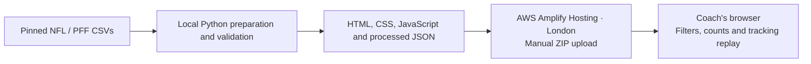

# AWS architecture

## Live deployment

[Open the Film Room](https://production.dq0yh80z3cam4.amplifyapp.com/) · AWS Amplify Hosting · Europe (London), `eu-west-2`.

The `opponent-pass-rush-brief` app uses a manual ZIP deployment to its `production` branch. Deployment 2 succeeded on 9 October 2026. The live page, animated replay and example tendency counts were checked in Chrome; the public HTML and 7,767-play index were also retrieved successfully.

Python prepares the historical dataset before deployment. Filtering, metric calculation and animation run in the browser. The browser loads `data/brief.json`, then a tracking bundle for the selected game. The application does not use a database, server-side API, generative AI or a prediction model.

The demo is public, including its bundled processed data. No viewer login is implemented. Hosting costs depend on the account plan, credits, storage and traffic; no free-hosting guarantee or latency improvement is claimed.

## Included alternative: S3 and CloudFront

`infra/aws/template.json` and `infra/aws/deploy.sh` define a separate, **unused** deployment option: private S3 app/data buckets, CloudFront with Origin Access Control, and CloudFormation-managed releases. The template has been checked locally but was not used for the live Amplify site. Its cache policies, bucket settings and access defaults must not be described as verified settings of the Amplify deployment.

The [deployment guide](AWS_DEPLOYMENT.md) covers the live Amplify workflow first and retains the alternative stack instructions for reference. There is no need to deploy both.

## Possible future work

Automated data preparation on AWS, persistent coach notes and additional seasons would need separate implementation and validation. CodeBuild, Bedrock, Lambda, Athena and DynamoDB are not part of the current application.
