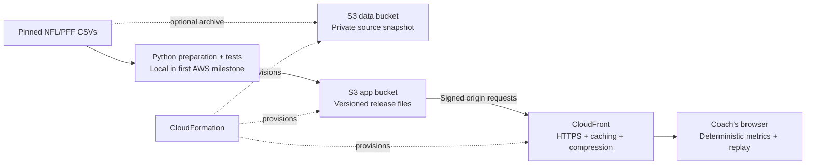

# Opponent Pass-Rush Brief

**A coaching brief with the plays behind it.** Select an opponent and down/distance, identify pressure sources and defensive tendencies, then inspect real tracking replays. Built for an offensive-line or offensive coach preparing protections.

**Historical scope:** NFL 2021, Weeks 1–8. **32 defenses · 122 games · 7,767 eligible plays with replays.** Scouting is from Pro Football Focus; tracking is from NFL Next Gen Stats. No fabricated plays, coordinates or performance claims.

## Project status

| Area | Status |
| --- | --- |
| Working coaching application | Implemented and locally/browser tested |
| Existing private prototype | [Open the Sites demo](https://opponent-pass-rush-brief.leventkoymen.chatgpt.site); this is not the AWS deployment |
| NFL/PFF data preparation | Implemented; pinned source and reproducible metrics |
| AWS architecture | S3 + CloudFront, defined with CloudFormation |
| AWS deployment template | Included and locally validated; **not deployed to AWS yet** |
| AWS processing pipeline | CodeBuild proposed as a later milestone; not provisioned |
| Generative AI / predictive model | Not used by the current product |

No particular AWS service is required by the event according to the project owner. The service choices below follow the MVP's actual needs. The organizer's exact submission format has not been supplied; the included worksheet is a draft.

## The coaching workflow

The default screen has one path: **choose a defense → watch a play → read the result**. Orange identifies the defender to watch; gold identifies the quarterback to protect. Names and jersey numbers match the field labels. One Play button animates the real tracking; the timeline lets the coach inspect movement.

Optional sections keep the first view short:

- **Filter by game situation** — down and distance, with active filters and sample size visible beside the defense selection.
- **Choose another play** — supporting plays, search, evidence filters and sorting.
- **See the opponent’s three tendencies** — pressure sources, five-plus-rusher frequency and coverage, with denominators and evidence links.
- **Replay controls & play details** — player selection, guided stages, frame steps, timing, scouting records and full-field view.
- **New to football?** — a short guide to the players and shapes.

The initial Cleveland example highlights Myles Garrett (#95) and Justin Fields (#1). “Reset to example” restores that play and collapses the optional browsing sections.

Example validation anchors: Cleveland generated pressure on **93/227 eligible dropbacks (41.0%)**. Myles Garrett received pressure credit on **40/179 pass-rush reps (22.3%)**. These are historical descriptive counts, not forecasts or proof of individual blocker failure.

## Run locally

**Node.js 18 or newer is the only requirement to run the website.** No package installation, account, API key or build step is needed. The processed data are included. Python is only needed if rebuilding from raw CSVs.

1. Extract the project download.
2. On macOS, open **Start Film Room.command**. On Windows, open **Start Film Room.bat**. Alternatively, open a terminal in the project folder and run:

```sh
npm start
```

3. Your browser opens [http://127.0.0.1:4173](http://127.0.0.1:4173). Keep the terminal window open while using the app; press Ctrl+C to stop it.

The server listens only on this computer. This is a local website, not a public deployment. Do not open `index.html` directly: browsers need HTTP to load the bundled JSON. The interface, fonts, metrics and replays work offline; only optional source-reference links require internet access.

If the port is busy: `npm start -- --port 4174`. To avoid opening a browser automatically: `npm start -- --no-open`. To run checks: `npm test`. If Node is unavailable, the equivalent Python fallback is `python3 -m http.server 4173 --bind 127.0.0.1 --directory dist`, followed by opening the local URL yourself.

## AWS architecture



The existing application is read-only and operates on a fixed sample. S3 stores the processed app/data and an optional source archive; CloudFront delivers files; CloudFormation makes deployment reproducible. Filtering and replay stay in the browser. We do not need a query API, database or generative model for this workflow.

AWS recommends CloudFront Origin Access Control for restricting an S3 origin. The template keeps both buckets' public access blocked and allows the designated distribution to read only app release objects. [AWS origin-access documentation](https://docs.aws.amazon.com/AmazonCloudFront/latest/DeveloperGuide/private-content-restricting-access-to-s3.html).

**Access is a separate decision:** the distribution starts disabled. Setting `EnablePublicDemo=true` enables a public demo, including access to processed JSON. S3 privacy does not authenticate website viewers. Restricted judge access requires a viewer-authentication implementation before enabling serving; it is not provided by this template.

For deployment without installing anything on your computer, upload the AWS package to CloudShell and use `infra/aws/deploy.sh`. The [AWS deployment runbook](AWS_DEPLOYMENT.md) starts with that browser-only route. It covers change-set review, asset uploads, access, smoke tests, release updates, rollback and cleanup. No AWS resources or charges were created as part of preparing this package.

## Delivery plan

| Milestone | Deliverable | Completion condition |
| --- | --- | --- |
| 1. AWS-hosted MVP | Existing product on S3/CloudFront | AWS URL and browser smoke test pass; judge access works; original metrics reconcile |
| 2. Reproducible AWS processing, if useful | CodeBuild prepares and validates a candidate release from a pinned S3 snapshot | Failed validation cannot replace the live release; audit and logs are retained |
| 3. Requirement-led extensions | Persistent review lists, larger data queries or grounded narrative summaries | A specific user/judging requirement justifies the added service and its validation |

See [architecture and tradeoffs](AWS_ARCHITECTURE.md) for component status, acceptance criteria and cost inputs. See the [submission worksheet and 3-minute demo script](HACKATHON_SUBMISSION.md) for the event deliverables.

## Data and methodology

Pinned source: [NFL Big Data Bowl regional event dataset](https://github.com/ThompsonJamesBliss/nfl-big-data-bowl-regional-event-data), revision `85da22eeff2f1d5be106faa9dfe06a1205f2defd`.

| Input / output | Count |
| --- | ---: |
| Games | 122 |
| Original plays | 8,557 |
| Player scouting rows | 188,254 |
| Original tracking observations | 8,314,178 |
| Excluded plays | 790 |
| Eligible plays / replays | 7,767 |

Eligibility excludes recorded penalty yardage or foul names, “No Play” descriptions and two-point attempts. This is a passing-situation sample, not every offensive snap.

- **Team pressure:** any PFF hit/hurry/sack credit on a play, counted once.
- **Rusher pressure rate:** credited pass-rush reps divided by that player's pass-rush reps; multiple credit types on one rep count once.
- **Extra-rusher frequency:** at least five unique PFF Pass Rush players divided by eligible dropbacks. This is not a complete blitz-scheme label.
- **Coverage tendency:** a PFF coverage label's count divided by plays with known coverage; unknown labels are reported separately.
- **Blocker responsibility:** PFF pressure-allowed labels are shown separately; pressure or proximity does not establish a blocker failure.

Small splits under 30 plays are flagged. Rates are descriptive associations, not causal claims. The [full methodology](METHODOLOGY.md) documents timing, coordinates, denominators and limitations. `dist/data/audit.json` contains machine-readable counts and source file hashes.

The originally referenced `/workspace/nfl-analysis/report.md`, `opportunity_map.png` and `example_play.png` were unavailable. Their contents have not been presented as inspected; this project independently rebuilt the brief from the public CSVs.

## Tracking limitations

The app uses observed coordinates and rotates left-moving offenses so every replay moves right. Timing uses frame differences at 10 Hz because the source timestamps have whole-second precision. The recorded snap tag takes precedence over the automatic tag. Twenty-three eligible plays lack a snap tag; the app does not invent one.

Throw/sack timing requires the corresponding event tag. QB displacement measures movement from snap, not protection quality or intended reads. Tracking stops at the supplied window, so complete routes, catch points, YAC and full pre-snap motion are not reliably supported. The orange ring identifies the selected defender to watch; a separate label states whether that player has a whole-play pressure credit. It does not indicate pressure onset. The gold diamond marks the quarterback; white squares mark PFF Pass Block players.

## Rebuild and verify

Raw CSVs are not duplicated in this source package. Rebuilding downloads about 865 MB of source CSV data.

```sh
python3 scripts/download_data.py --output /path/to/raw-data
python3 scripts/prepare_data.py --input /path/to/raw-data --output dist/data
npm test
python3 scripts/validate_source.py --input /path/to/raw-data --output dist/data
```

Tests cover historical anchors, all team/down/distance partitions, takeaway evidence counts, empty samples, attribution and all 7,767 replay structures. AWS template tests check the publication default, bucket isolation, origin restrictions and release/caching configuration. The independent raw validator checks every eligible play's pressure/rusher IDs and outcomes, plus every coordinate of one play in each of 122 games. `source-validation.json` records the prior successful raw-data check.

The 15 automated tests include key-player selection, missing timing tags and the protection camera, local HTTP serving, missing-file responses and refusal to serve files outside the app. Desktop and 390px mobile browser checks passed for the guided replay, manual player selection, uncredited players, missing snap tags and empty search results. AWS template validation is not an AWS deployment test; the AWS runbook lists the remaining live checks.

## Repository guide

```text
Start Film Room.command       macOS local launcher
Start Film Room.bat           Windows local launcher
scripts/serve.mjs             Local website server; Node built-ins only
dist/                         Browser application and processed dataset
  data/audit.json              Data provenance and validation anchors
  data/brief.json              Eligible plays, player lookup and scouting labels
  data/tracking/               Per-game observed tracking bundles
scripts/                      Source download, preparation and raw validation
infra/aws/template.json       CloudFormation infrastructure definition
tests/                        Metric/replay and AWS template tests
docs/AWS_ARCHITECTURE.md       Service choices, diagram and delivery milestones
docs/AWS_DEPLOYMENT.md         Deployment, access, rollback and cleanup runbook
docs/HACKATHON_SUBMISSION.md   Submission draft and demonstration script
docs/METHODOLOGY.md            Detailed original implementation/data notes
.openai/hosting.json           Existing Sites identity; not an AWS resource
```

No ownership or license for NFL/PFF data is asserted by this repository. Use the event's applicable dataset terms when choosing submission and hosting access. Team names, organizer fields, AWS Region/account and the eventual AWS URL must be filled with actual information before submission.
